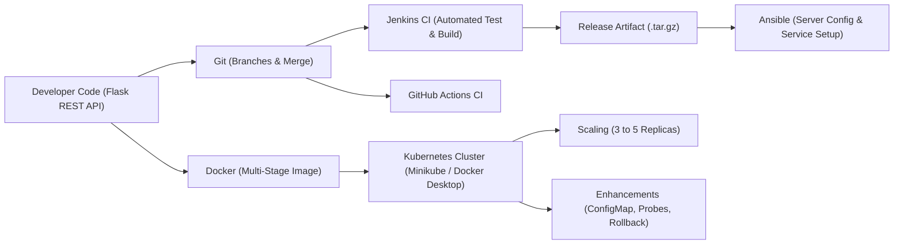

# Campus Lab Resources Management — DevOps CI/CD & Kubernetes Pipeline

A comprehensive, production-grade DevOps implementation for the **Campus Lab Resources Management API**, demonstrating continuous integration, configuration management, containerization, orchestration, and automated scaling.

Course: **DevOps (25CIAEC59 / 25CYAEC59)** | Total Marks: **20 (Component 1: 10 + Component 2: 10)**

---

## 1. Project Overview & Architecture

This project implements an end-to-end assembly line connecting source code to cloud-native production deployment:



### Application Domain: Campus Lab Resources Management
A lightweight REST API microservice designed to track and allocate campus laboratory equipment (AI/Deep Learning GPU servers, 3D printers, digital oscilloscopes, Cisco switch racks, and IoT kits) across departments.

- `GET /` — Service metadata and available endpoints
- `GET /health` — Microservice health status, environment, and total inventory count
- `GET /api/resources` — List all campus lab resources (supports `?status=Available` or `?lab=AI`)
- `GET /api/resources/<id>` — Retrieve detailed information for a specific resource
- `POST /api/resources` — Register new lab equipment or book a workstation

---

## 2. Directory Structure

```text
campus-lab-devops-project/
├── .github/
│   └── workflows/
│       └── ci.yml                 # CI Enhancement: GitHub Actions pipeline
├── ansible/
│   ├── inventory.ini              # Server inventory configuration
│   ├── playbook.yml               # Ansible Playbook with variables & handlers
│   └── roles/
│       └── campus_lab_app/
│           ├── defaults/main.yml  # Role variables
│           ├── handlers/main.yml  # Handlers (restart service on change)
│           ├── tasks/main.yml     # Provisioning tasks (install runtime, unpack, start)
│           └── templates/
│               └── campus-lab.service.j2 # Systemd service unit template
├── k8s/
│   ├── configmap.yaml             # Deployment Enhancement 1: Decoupled settings
│   ├── deployment.yaml            # Deployment (3 replicas, liveness/readiness probes)
│   └── service.yaml               # NodePort Service (Port 30080 -> 5000)
├── report/
│   └── DevOps_Project_Report.md   # Complete Submission Report (Ready for Word/PDF)
├── src/
│   └── app.py                     # Campus Lab REST API microservice
├── tests/
│   ├── __init__.py
│   └── test_app.py                # Unit test suite (pytest + unittest compatible)
├── .dockerignore
├── .gitignore
├── Dockerfile                     # Multi-stage container build
├── Jenkinsfile                    # Jenkins CI Pipeline script
├── package.py                     # Build & artifact packaging script
├── repo_link.txt                  # Submission file: GitHub repository link
└── requirements.txt               # Application runtime dependencies
```

---

## 3. Component 1 Execution Guide (10 Marks)

### Step 1: Run the App Locally & Confirm
1. Install dependencies:
   ```bash
   pip install -r requirements.txt
   ```
2. Start the application:
   ```bash
   python src/app.py
   ```
3. Test endpoints with `curl` or Postman:
   ```bash
   # Check service info
   curl http://127.0.0.1:5000/

   # Check health
   curl http://127.0.0.1:5000/health

   # List all lab equipment
   curl http://127.0.0.1:5000/api/resources

   # Filter only available equipment
   curl http://127.0.0.1:5000/api/resources?status=Available

   # Add a new resource
   curl -X POST http://127.0.0.1:5000/api/resources \
     -H "Content-Type: application/json" \
     -d '{"name": "Jetson Orin Nano", "lab": "Edge AI Lab", "type": "Compute", "status": "Available"}'
   ```

### Step 2: Git Setup & Branch History
The repository has already been configured with a feature branch and merge:
```bash
# Verify branches and merge in terminal
git log --graph --oneline --all
```
Output shows:
```text
*   fa33a7f Merge branch 'feature/lab-endpoints' into main
|\  
| * dfd8689 feat: add lab equipment search filter and booking validation enhancement
|/  
* 1899802 feat: initial commit with campus lab resource management core structure
```

To push to your remote GitHub repository:
```bash
git remote add origin https://github.com/<YOUR_USERNAME>/campus-lab-devops-pipeline.git
git push -u origin main
git push origin feature/lab-endpoints
```

### Step 3: Run the Build Locally
Run the build script to generate the distributable release package:
```bash
python package.py
```
This produces `dist/campus-lab-api-1.0.0.tar.gz`.

### Step 4 & Step 5: Jenkins Pipeline & CI Enhancements
1. Open Jenkins (`http://localhost:8080`).
2. Click **New Item** -> Name it `campus-lab-pipeline` -> Select **Pipeline** -> Click **OK**.
3. Under **Build Triggers**, check **Poll SCM** and set Schedule to:
   ```text
   H/2 * * * *
   ```
4. Under **Pipeline**:
   - Definition: **Pipeline script from SCM**
   - SCM: **Git**
   - Repository URL: Your GitHub repo URL (e.g. `https://github.com/<YOUR_USERNAME>/campus-lab-devops-pipeline.git`)
   - Branch Specifier: `*/main`
   - Script Path: `Jenkinsfile`
5. Click **Save** and click **Build Now**.
6. **CI Enhancements implemented**:
   - **Automated Tests in CI**: The `Run Unit Tests` stage runs `pytest tests/` before packaging.
   - **GitHub Actions alongside Jenkins**: `.github/workflows/ci.yml` triggers automatically on GitHub upon every commit.
   - **Archived Artifact**: Jenkins archives `dist/campus-lab-api-1.0.0.tar.gz`.

---

## 4. Component 2 Execution Guide (10 Marks)

### Step 1: Run the Ansible Playbook
The Ansible configuration contains:
- **Inventory**: `ansible/inventory.ini`
- **Variable**: `app_port`, `app_name`, `app_dir`, `artifact_src`
- **Handler**: `restart campus-lab-api` triggered whenever files or templates change
- **Role**: `campus_lab_app` created via galaxy structure

Execute the playbook (from a Linux / WSL / VM terminal):
```bash
cd ansible
ansible-playbook -i inventory.ini playbook.yml
```
*(In dry-run / check mode: `ansible-playbook -i inventory.ini playbook.yml --check`)*

### Step 2: Containerize with Docker
Build and test the multi-stage Docker image locally:
```bash
# Build Docker image
docker build -t campus-lab-api:v1 .

# Run the container
docker run -d -p 5000:5000 --name lab-app campus-lab-api:v1

# Verify the container is running and healthy
docker ps
curl http://localhost:5000/health

# Stop and remove test container
docker rm -f lab-app
```

### Step 3: Deploy on Kubernetes
1. Ensure your local Kubernetes cluster is running (Minikube or Docker Desktop Kubernetes):
   ```bash
   minikube start
   # Or enable Kubernetes in Docker Desktop Settings
   ```
2. If using Minikube, load the local image into the cluster:
   ```bash
   minikube image load campus-lab-api:v1
   ```
3. Apply all Kubernetes manifests:
   ```bash
   kubectl apply -f k8s/configmap.yaml
   kubectl apply -f k8s/deployment.yaml
   kubectl apply -f k8s/service.yaml
   ```
4. Verify the 3 pods are running and service is active:
   ```bash
   kubectl get pods -l app=campus-lab-api
   kubectl get svc campus-lab-service
   ```
5. Test the application endpoint:
   ```bash
   # If using Minikube:
   minikube service campus-lab-service --url

   # Or via port-forward / NodePort:
   curl http://localhost:30080/health
   # or
   kubectl port-forward svc/campus-lab-service 5000:5000
   curl http://localhost:5000/health
   ```

### Step 4: Demonstrate Scaling
1. Scale up from 3 to 5 replicas:
   ```bash
   kubectl scale deployment campus-lab-deployment --replicas=5
   ```
2. Confirm 5 pods are running:
   ```bash
   kubectl get pods -l app=campus-lab-api
   ```
3. Scale back down to 3 replicas:
   ```bash
   kubectl scale deployment campus-lab-deployment --replicas=3
   kubectl get pods -l app=campus-lab-api
   ```

### Step 5: Deployment Enhancements
The project includes three distinct deployment enhancements:
1. **ConfigMap for Settings** (`k8s/configmap.yaml`): App port and campus identification are externalized from the deployment manifest.
2. **Liveness and Readiness Probes** (`k8s/deployment.yaml`): Integrated HTTP health checks that monitor container vitality and traffic readiness at `/health`.
3. **Rollback Demonstration**:
   ```bash
   # Simulate a broken deployment (non-existent image tag)
   kubectl set image deployment/campus-lab-deployment campus-lab-container=campus-lab-api:v99-broken

   # Observe rollout failure / ImagePullBackOff
   kubectl rollout status deployment/campus-lab-deployment

   # Execute automated rollback
   kubectl rollout undo deployment/campus-lab-deployment

   # Verify all pods recover to healthy status
   kubectl rollout status deployment/campus-lab-deployment
   kubectl get pods
   ```

---

## 5. Report & Submission Checklist

- [x] Application source code (`src/app.py`)
- [x] Automated test suite (`tests/test_app.py`)
- [x] Git branch history showing at least 2 branches and a merge
- [x] Build and packaging script (`package.py`)
- [x] Declarative Jenkins pipeline (`Jenkinsfile`)
- [x] CI Enhancement (`.github/workflows/ci.yml` and automated test stage)
- [x] Ansible Playbook with inventory, variables, handlers, and roles (`ansible/`)
- [x] Multi-stage Dockerfile (`Dockerfile`)
- [x] Kubernetes Deployment (3 replicas) and Service (`k8s/`)
- [x] Kubernetes scaling demonstrated (3 -> 5 -> 3 replicas)
- [x] Deployment Enhancements (ConfigMap, Liveness/Readiness Probes, Rollback)
- [x] Submission repository link file (`repo_link.txt`)
- [x] Full Academic Report Draft (`report/DevOps_Project_Report.md`)

---

## 6. Resume Framing Template

```text
Campus Lab Resources Management — CI/CD Pipeline & Kubernetes Deployment | [Your GitHub Link]
Python (Flask), Git, Jenkins, GitHub Actions, Docker, Ansible, Kubernetes

• Engineered a REST API for Campus Lab Resource Management and automated its build and test pipeline using Jenkins and GitHub Actions, triggered on every Git push.
• Implemented automated unit test stages in CI and artifact version archiving, guaranteeing code quality before distribution.
• Containerized the microservice with a multi-stage Dockerfile and deployed to a local Kubernetes cluster with 3 replicas, exposed via NodePort Service.
• Configured server provisioning and automated service lifecycle management using an Ansible playbook with modular roles and handlers.
• Implemented Kubernetes ConfigMaps for environment isolation, configured liveness/readiness health probes, demonstrated dynamic replica scaling from 3 to 5 pods, and verified zero-downtime rollback recovery.
```
