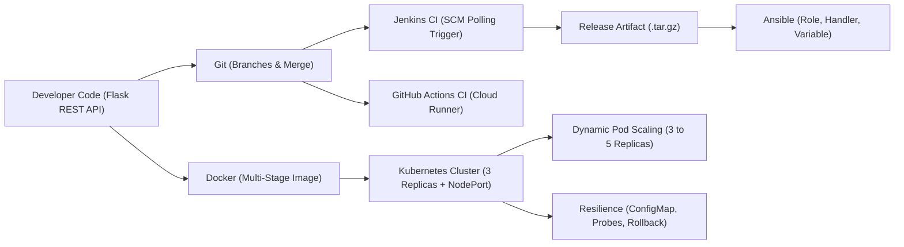

# Campus Lab Resources Management — DevOps CI/CD & Kubernetes Pipeline

A production-grade microservice and automated DevOps assembly line for managing campus laboratory equipment, featuring continuous integration, infrastructure automation, containerization, and cloud-native orchestration.

---

## 1. Abstract

**Campus Lab Resources Management** is an automated microservice engineered to streamline the inventory tracking, allocation, and health monitoring of specialized laboratory assets across university departments (e.g., NVIDIA GPU workstations, 3D printers, digital storage oscilloscopes, Cisco network switch racks, and IoT development kits).

This repository implements a complete, end-to-end DevOps lifecycle connecting application source code to production deployment:
- **Version Control:** Git workflow with feature branching and non-fast-forward merge history.
- **Continuous Integration:** Automated build and unit test pipeline orchestrated via Jenkins declarative pipelines and GitHub Actions.
- **Artifact Management:** Release archiving of verified distribution packages.
- **Configuration Management:** Infrastructure as Code using Ansible playbooks with modular roles, variables, and event handlers.
- **Containerization:** Optimized multi-stage Docker build producing a secure, lightweight runtime container.
- **Cloud-Native Orchestration:** Kubernetes Deployment with 3 replicas, NodePort service, decoupled ConfigMaps, liveness/readiness health probes, dynamic horizontal scaling (3 to 5 pods), and automated rollback recovery.

---

## 2. Architecture & Pipeline Workflow



---

## 3. Microservice Endpoints & Functionality

The application (`src/app.py`) provides an in-memory REST API with zero external database dependencies:

| Method | Endpoint | Description |
| :---: | :--- | :--- |
| `GET` | `/` | API discovery metadata, campus identifier, and environment information |
| `GET` | `/health` | Health check endpoint returning service status (`UP`), environment, and resource count |
| `GET` | `/api/resources` | List all lab resources (supports filtering via `?status=Available` or `?lab=AI`) |
| `GET` | `/api/resources/<id>` | Fetch detailed resource information by ID (returns 404 if not found) |
| `POST` | `/api/resources` | Register new laboratory equipment or update student allocation (returns 201 Created) |

---

## 4. Repository Structure

```text
campus-lab-devops-project/
├── .github/
│   └── workflows/
│       └── ci.yml                 # Cloud CI workflow for GitHub Actions
├── ansible/
│   ├── inventory.ini              # Target host definitions
│   ├── playbook.yml               # Ansible Playbook with variables & handlers
│   └── roles/
│       └── campus_lab_app/
│           ├── defaults/main.yml  # Role default variables
│           ├── handlers/main.yml  # Handlers (restart service on file/config change)
│           ├── tasks/main.yml     # Provisioning tasks (install runtime, copy artifact, start)
│           └── templates/
│               └── campus-lab.service.j2 # Systemd service unit template
├── k8s/
│   ├── configmap.yaml             # Decoupled application settings
│   ├── deployment.yaml            # Kubernetes Deployment (3 replicas, liveness/readiness probes)
│   └── service.yaml               # NodePort Service (Port 30080 -> 5000)
├── report/
│   └── DevOps_Project_Report.md   # Complete project documentation and submission report
├── src/
│   └── app.py                     # Campus Lab REST API microservice
├── tests/
│   ├── __init__.py
│   └── test_app.py                # Automated unit test suite (pytest & unittest compatible)
├── .dockerignore
├── .gitignore
├── Dockerfile                     # Multi-stage container build
├── Jenkinsfile                    # Jenkins CI Declarative Pipeline script
├── package.py                     # Build & artifact packaging script
├── repo_link.txt                  # Repository link file
├── requirements.txt               # Python runtime dependencies
└── run-local-tests.ps1            # Automated local project verification script
```

---

## 5. Pipeline Stages & Execution

### Phase 1: Local Development & Verification
1. Install dependencies and start the REST API:
   ```bash
   pip install -r requirements.txt
   python src/app.py
   ```
2. Test endpoints using `curl`:
   ```bash
   curl http://127.0.0.1:5000/
   curl http://127.0.0.1:5000/health
   curl http://127.0.0.1:5000/api/resources
   ```
3. Run automated unit tests:
   ```bash
   pytest tests/ --verbose
   ```
4. Build release package:
   ```bash
   python package.py
   ```

### Phase 2: Git Version Control Workflow
The repository utilizes branch-based development with explicit merge tracking:
- `main`: Production-ready, stable codebase.
- `feature/lab-endpoints`: Feature branch implementing search filters and booking validations.

Inspect the commit and merge graph:
```bash
git log --graph --oneline --all
```

### Phase 3: Continuous Integration (Jenkins & GitHub Actions)
- **Jenkins Pipeline (`Jenkinsfile`):**
  - **SCM Polling Trigger:** Configured with `pollSCM('H/2 * * * *')` to automatically detect new commits.
  - **Test Stage:** Executes automated unit tests before the build step to prevent regressions.
  - **Build Stage:** Packages the application via `package.py`.
  - **Post-Build Action:** Automatically archives the versioned artifact (`dist/*.tar.gz`).
- **GitHub Actions (`.github/workflows/ci.yml`):**
  - Triggers on every push and pull request, builds on Ubuntu runners, runs tests, and stores artifacts.

### Phase 4: Configuration Management (Ansible)
Automates host preparation and service provisioning without manual SSH setup:
```bash
cd ansible
ansible-playbook -i inventory.ini playbook.yml
```
- **Variables:** Configures application ports, directories, and paths dynamically.
- **Handlers:** Notifies service restarts only when configuration or application files change.
- **Role:** Packaged under `campus_lab_app` for reusability and idempotency.

### Phase 5: Containerization (Docker)
Builds a minimal, secure container using a multi-stage `Dockerfile`:
```bash
# Build multi-stage image
docker build -t campus-lab-api:v1 .

# Run container locally
docker run -d -p 5000:5000 --name campus-lab-app campus-lab-api:v1
curl http://localhost:5000/health
```

### Phase 6: Cloud-Native Orchestration (Kubernetes)
1. **Deploy to Cluster:**
   ```bash
   kubectl apply -f k8s/configmap.yaml
   kubectl apply -f k8s/deployment.yaml
   kubectl apply -f k8s/service.yaml
   ```
2. **Verify Pods & Service:**
   ```bash
   kubectl get pods -l app=campus-lab-api
   kubectl get svc campus-lab-service
   ```
3. **Demonstrate Horizontal Scaling:**
   ```bash
   # Scale up to 5 replicas
   kubectl scale deployment campus-lab-deployment --replicas=5
   kubectl get pods -l app=campus-lab-api

   # Scale back to 3 replicas
   kubectl scale deployment campus-lab-deployment --replicas=3
   kubectl get pods -l app=campus-lab-api
   ```
4. **Automated Rollback Demonstration:**
   ```bash
   # Trigger faulty update
   kubectl set env deployment/campus-lab-deployment APP_PORT=9999
   kubectl rollout status deployment/campus-lab-deployment

   # Undo rollout to restore healthy state
   kubectl rollout undo deployment/campus-lab-deployment
   kubectl rollout status deployment/campus-lab-deployment
   ```
